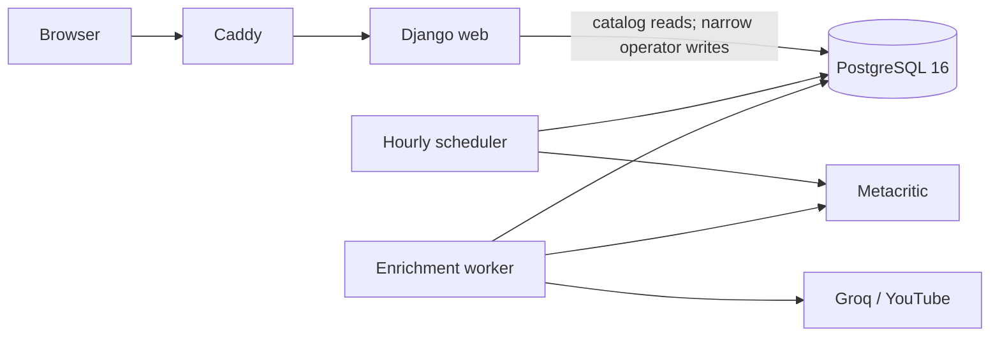

# Metacritic AI Assignment

A Django game catalog with hourly Metacritic discovery, saved review snapshots,
separate critic/user AI summaries and similar-game navigation. Search, platform
filters, sorting and pagination retain context when returning from a card.
Public service monitoring and an authorized operator trigger share the normal
processing machinery. YouTube Let's Plays are an experimental post-submission feature.

[Project snapshot](PROJECT_STATUS.md) describes architecture, active policies,
limits and deployment observations. [action_plan.md](action_plan.md) is the only
current task/gate tracker. The original take-home submission and later development
are distinguished there and in [historical observations](docs/history/operations.md).

## Local development

Prerequisites: Docker Engine/Compose 2.24.4+, Python 3.12 and uv 0.12.11.
Use `.venv-app`; preserve the existing research `.venv`. From PowerShell:

```powershell
python -m pip install uv==0.12.11
$env:UV_PROJECT_ENVIRONMENT = '.venv-app'
python -m uv sync --locked --python 3.12
.\.venv-app\Scripts\python.exe scripts/init_env.py
```

Skip initialization when `.env.app` already exists; the script refuses to overwrite
it. Secrets/configuration stay outside Git and build context. For host Django setup,
upgrades, lint/type commands and diagnostics, see [development guide](docs/development.md).

## Verification and container preview

The canonical suite uses Linux/Python 3.12/PostgreSQL 16, including Django tests,
permission boundaries, offline evaluations and the pinned Playwright processing-to-browser
journey. External inputs are controlled; checks make no live Metacritic/paid AI calls.

```powershell
docker compose --env-file .env.app build web checks
docker compose --project-name metacritic-isolated-checks --env-file .env.app -f compose.yaml -f compose.ci.yaml run --rm checks
```

Use this separate checks project even when the application is already running:
role tests need an unmigrated application database. It owns a separate volume,
publishes no database port and creates a disposable test database. Run suites
sequentially; do not start the app profile in that project.

After checks succeed:

```powershell
docker compose --env-file .env.app --profile app up -d --wait
.\.venv-app\Scripts\python.exe scripts/smoke.py http://127.0.0.1:18081 --version local
```

Open [http://127.0.0.1:18081](http://127.0.0.1:18081). Preview uses plain HTTP.
Check catalog pages, search/filter/sort, card return context, mobile layout and
monitoring. `/health/live/` checks the process; `/health/ready/` checks PostgreSQL.
[CI](.github/workflows/ci.yml) builds, checks and smoke-tests isolated containers;
it never deploys. A local pass does not establish hosted CI or public availability.

### Service activity (BON-21)

`/ops/` and `/ops/status/` show read-only process heartbeat, core progress, enrichment
queues and recent runs, with UTC timestamps. Completed core work does not mean all
reviews/summaries are complete. Monitoring never claims or releases work.
`OPS_MONITORING_ENABLED=false` disables monitoring after process restart.
[Monitoring contract](docs/bonus2_design.md).

### Manual run (BON-22)

Sign in at `/ops/login/`; an operator with `processing.trigger_run` can request an
ordinary batch on `/ops/`. Authentication, CSRF, durable idempotency, login throttles
and service-wide rate limits apply. No self-registration or Django admin UI.
Web is read-only for catalog data, with explicit narrow auth/manual-run grants.
[Provisioning and diagnostics](docs/development.md#operator-and-diagnostics).

## Deployment boundary

The [repository is public](https://github.com/ZheleznovAG/metacritic-ai-assignment).
The original submission VDS was deleted on 2026-09-21; its old hostname is historical.
Later deployment and its last recorded build are described in [PROJECT_STATUS](PROJECT_STATUS.md#deployment-and-repository-observations).
Current remote availability and a new public URL are not verified by local checks.

Production uses a prebuilt versioned image, internal PostgreSQL, explicit image
identity, backups and separately configured trusted TLS. Follow the
[deploy/upgrade runbook](deploy/README.md) and [relocation guide](deploy/relocation_runbook.md).
Keep project name and volumes; never use `down -v` for persistent deployments.

## Operations

See the [development guide](docs/development.md) for operator accounts, read-only
diagnostics, storage reports and summary refresh; the deployment runbook covers
backup/restore. Worker composition lives in `app/orchestration`; public `run_worker`
CLI and domain leases/state machines retain their interfaces.

## Baseline and research evidence

[Requirement/evidence index](docs/evidence.md), [design contracts](docs/design.md),
[ADRs](docs/decisions), [risk register](docs/risks.md) and
[methodology](methodology.md) explain decisions and their limitations.
Frozen evaluators test their stated oracles, not general AI/recommendation quality.
The [research freeze](docs/research_freeze.md) pins current policies, keeps accepted
quality failures and replay drift explicit, and proposes future independent holdout
protocols without claiming they have been executed.
Historical audit probes require their recorded source revision; commands and earlier
observations remain in the [dated README archive](docs/history/readme-20261005.md).

## Verified fixture demo

[Desktop catalog, game card and mobile screenshots](docs/evidence/fin-release/README.md)
come from a fresh isolated processing-to-browser journey with controlled fake inputs.
They demonstrate UI behavior without adding demonstration data to production.


